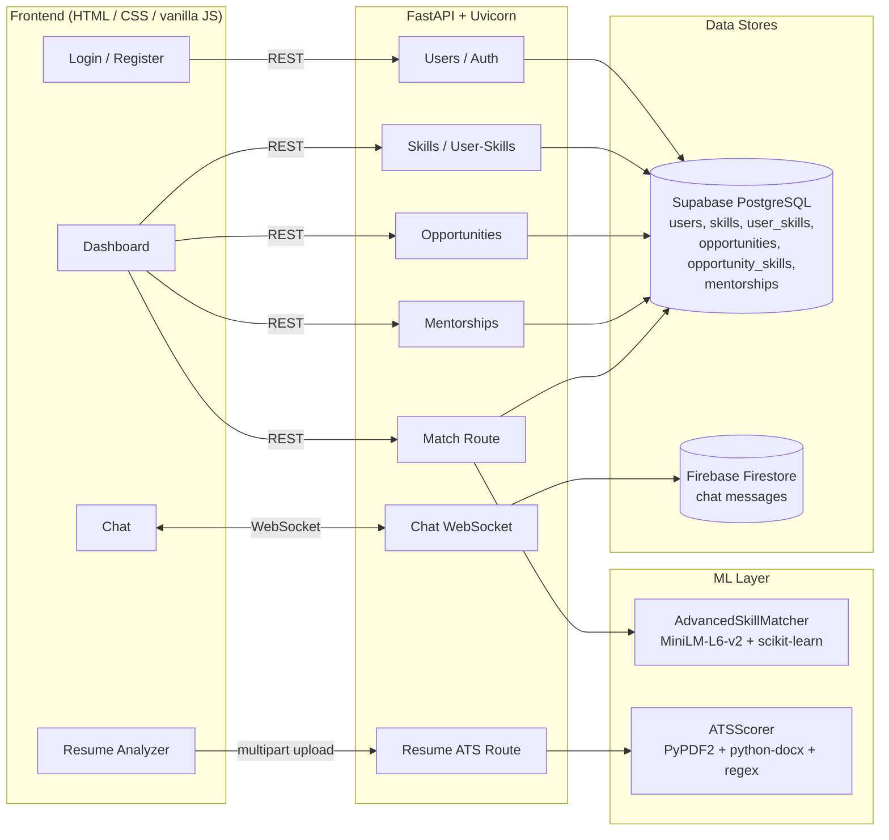
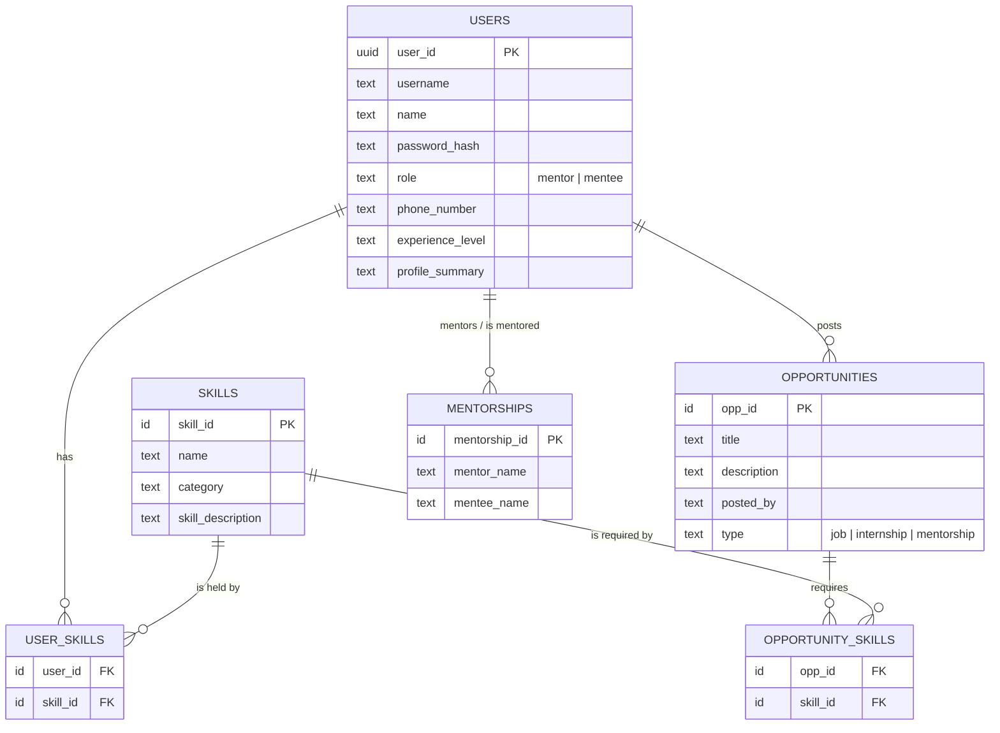

# SkillSync: Mentor–Mentee Matching Platform

SkillSync is a full-stack platform that connects mentees with the mentors best suited to help them. A hybrid matching engine embeds each user's skills with a Sentence-Transformer (`all-MiniLM-L6-v2`) and ranks candidates using a weighted blend of semantic similarity, skill complementarity, experience-level fit and overlap balance, returning a score breakdown and a plain-English explanation for every match. The backend is a FastAPI service on a relational Supabase (PostgreSQL) schema covering users, skills, opportunities and mentorships. Users chat in real time over a WebSocket endpoint backed by Firebase Firestore, and an ATS-style resume analyzer parses PDF/DOCX uploads and scores structure, completeness and readability with actionable feedback.

---

## Table of Contents

1. [Features](#features)
2. [Architecture](#architecture)
3. [Tech Stack](#tech-stack)
4. [Project Structure](#project-structure)
5. [Database Schema](#database-schema)
6. [Scoring Formulas](#scoring-formulas)
7. [Setup and Run](#setup-and-run)
8. [Environment Variables](#environment-variables)
9. [API Overview](#api-overview)
10. [WebSocket Chat Protocol](#websocket-chat-protocol)
11. [Docker and Cloud Run](#docker-and-cloud-run)
12. [Screenshots](#screenshots)
13. [Known Limitations and Roadmap](#known-limitations-and-roadmap)

---

## Features

- **Semantic skill matching:** embeddings capture that "ML" and "Machine Learning" are related, which keyword matching misses.
- **Explainable ranking:** every match returns a per-factor score breakdown and a short explanation.
- **Role-aware matching:** mentees are matched to mentors and mentors to mentees.
- **Skills, opportunities and mentorships:** CRUD APIs over a relational schema with junction tables for many-to-many relationships.
- **Real-time chat:** WebSocket messaging with typing indicators, online presence, read receipts and conversation list.
- **ATS resume scorer:** upload a PDF or DOCX and get a 0–100 score across four dimensions, plus prioritized suggestions.
- **Auth:** bcrypt password hashing and JWT issuance.

---

## Architecture



**Request flow, Find Matches:**
1. The dashboard sends `POST /match/match` with the requesting username.
2. The API loads the user and all users of the opposite role from Postgres, plus their skills.
3. `AdvancedSkillMatcher` embeds each skill set, computes four component scores, and combines them.
4. Results above the score threshold are sorted and returned with a breakdown and explanation.

---

## Tech Stack

| Layer | Technology | Why |
|---|---|---|
| API framework | FastAPI 0.109 + Uvicorn | Async, native WebSocket support, Pydantic validation, auto-generated OpenAPI docs |
| Relational DB | PostgreSQL on Supabase | Structured, interrelated data with integrity constraints; hosted with a REST layer (PostgREST) |
| Chat store | Firebase Firestore (`firebase-admin`) | Document model fits append-only messages; scales without management |
| Embeddings | `sentence-transformers` (`all-MiniLM-L6-v2`, 384-dim) + PyTorch | Small, fast on CPU, strong quality for short skill text |
| Similarity | scikit-learn cosine similarity, NumPy | Standard, well-tested vector math |
| Resume parsing | PyPDF2, python-docx | Text extraction from PDF and DOCX |
| Auth | passlib (bcrypt), python-jose (JWT) | Salted slow hashing; signed stateless tokens |
| Frontend | Vanilla HTML / CSS / JavaScript | No build step |
| Packaging | Docker (python:3.10-slim) | Reproducible builds, deployable to Cloud Run |

---

## Project Structure

```
skill_sync_dbms/
├── app/
│   ├── main.py                  # FastAPI app, CORS, router registration
│   ├── db.py                    # Supabase client factory
│   ├── ml/
│   │   ├── matcher.py           # AdvancedSkillMatcher (hybrid scoring)
│   │   └── ats_scorer.py        # ATSScorer (resume analysis)
│   ├── routes/
│   │   ├── users.py             # register, login, user CRUD
│   │   ├── skills.py            # skill CRUD
│   │   ├── user_skills.py       # user <-> skill mapping
│   │   ├── opportunities.py     # opportunity CRUD
│   │   ├── opportunity_skills.py# opportunity <-> skill mapping
│   │   ├── mentorships.py       # mentorship CRUD
│   │   ├── match.py             # matching endpoints
│   │   ├── chat.py              # WebSocket chat
│   │   └── resume_ats.py        # resume upload and scoring
│   ├── schemas/                 # Pydantic request models
│   ├── models/                  # table-name constants
│   └── utils/
│       ├── auth.py              # JWT creation
│       ├── hashing.py           # bcrypt helpers
│       └── firebase_chat_db.py  # Firestore chat wrapper
├── frontend/
│   ├── index.html               # login / register
│   ├── dashboard.html           # skills, matches, mentorships, opportunities
│   ├── chat.html                # real-time chat
│   ├── resume.html              # resume analyzer
│   └── style.css, chat.css
├── Dockerfile
├── requirements.txt
└── README.md
```

---

## Database Schema



Chat messages live in Firestore (`messages` collection): `from_user`, `to_user`, `message`, `created_at`, `read`.

---

## Scoring Formulas

### Match score

```
total = 0.40 · semantic_similarity
      + 0.25 · skill_complementarity
      + 0.20 · experience_match
      + 0.15 · skill_overlap_balance
```

| Component | Weight | Definition |
|---|---|---|
| **Semantic similarity** | 0.40 | Each user's skills are joined into one string (`"Python, SQL, ..."`) and embedded with `all-MiniLM-L6-v2` (384-dim). Score = `(cosine(a, b) + 1) / 2`, mapped to [0, 1]. |
| **Skill complementarity** | 0.25 | Share of the target's skills the requesting user lacks: `\|target − user\| / \|target\|` (case-insensitive). Rewards a mentor who knows things the mentee doesn't. |
| **Experience match** | 0.20 | Levels map to numbers (beginner 1, junior 2, intermediate 3, senior 4, expert/advanced 5). A target 1 level above scores 1.0, 2 above 0.9, 3 above 0.6, below 0.3, otherwise 0.4. |
| **Skill overlap balance** | 0.15 | Bell curve on Jaccard overlap centered at 0.3: `max(0, 1 − \|0.3 − J\| / 0.7)` where `J = \|A ∩ B\| / \|A ∪ B\|`. Rewards some shared ground without being identical. |

Matches with `total > 0.2` are returned, sorted descending, with a breakdown and explanation.

**Worked example:** mentee (Python, SQL; beginner) vs. mentor (Python, Machine Learning, Docker; senior). Semantic 0.80, complementarity 2/3 = 0.667, experience (gap 3) 0.60, overlap J = 0.25 gives 0.929. Total = 0.40(0.80) + 0.25(0.667) + 0.20(0.60) + 0.15(0.929) = **0.746**.

### Resume (ATS-friendliness) score

```
overall = 0.30 · contact + 0.30 · structure + 0.25 · formatting + 0.15 · readability
```

| Sub-score | What it checks |
|---|---|
| **Contact (30%)** | Email, phone, LinkedIn, GitHub/portfolio link, location, name at top |
| **Structure (30%)** | Presence of experience, education, skills, projects, certifications, summary sections, with a bonus for 4+ |
| **Formatting (25%)** | Bullet count, 400–1200 word length, dates, quantified achievements, action verbs |
| **Readability (15%)** | Average sentence length, passive-voice ratio, excessive ALL CAPS, spacing consistency |

Each sub-score is out of 100. Feedback tiers: 90+ excellent, 75+ good, 60+ needs optimization, 40+ significant improvements, below 40 major revisions. This is a **format and structure checker**, not a simulation of a specific employer's ATS.

---

## Setup and Run

### Prerequisites

- Python 3.10+
- A [Supabase](https://supabase.com) project with the tables above created
- (For chat persistence) A [Firebase](https://firebase.google.com) project with Firestore enabled and a service-account key
- ~1 GB free disk (PyTorch and the MiniLM model download on first run)

### 1. Clone and install

```bash
git clone https://github.com/shreyaravi0/skill_sync_dbms.git
cd skill_sync_dbms

python -m venv venv
source venv/bin/activate        # Windows: venv\Scripts\activate
pip install -r requirements.txt
```

### 2. Configure environment

Create a `.env` file in the project root (see [Environment Variables](#environment-variables)).

For Firestore, download a service-account key from **Firebase Console → Project Settings → Service Accounts** and save it as:

```
app/utils/firebase_key.json
```

Both `.env` and this key are in `.gitignore`. **Never commit them.**

### 3. Run the backend

```bash
uvicorn app.main:app --reload --port 8000
```

- API root: http://127.0.0.1:8000
- Interactive docs: http://127.0.0.1:8000/docs

The first start downloads the MiniLM model (~90 MB) and loads it once into memory.

### 4. Run the frontend

The frontend is static files. Serve the folder and open it in a browser:

```bash
cd frontend
python -m http.server 5500
```

Open http://127.0.0.1:5500/index.html. The frontend calls the API at `http://127.0.0.1:8000` and the WebSocket at `ws://127.0.0.1:8000/ws`. Change those constants if your backend runs elsewhere.

### 5. Try it

1. Register a mentor and a mentee on `index.html`.
2. Add skills to each profile on the dashboard.
3. Click **Find Matches** as the mentee to see ranked mentors with score breakdowns.
4. Open a chat with a match, or upload a resume on the Resume page.

---

## Environment Variables

| Variable | Required | Description |
|---|---|---|
| `SUPABASE_URL` | Yes | Your Supabase project URL, e.g. `https://xxxx.supabase.co` |
| `SUPABASE_SERVICE_ROLE_KEY` | Yes | Supabase service-role key. **Server-side only; bypasses Row Level Security.** Never expose to the frontend. |
| `JWT_SECRET` | Yes | Long random string used to sign tokens (e.g. `openssl rand -hex 32`) |
| `JWT_ALGORITHM` | Yes | Signing algorithm, e.g. `HS256` |

**Firebase:** place the service-account JSON at `app/utils/firebase_key.json`. On Google Cloud Run you can instead attach a service account to the service and use Application Default Credentials, with no key file.

Example `.env`:

```env
SUPABASE_URL=https://your-project.supabase.co
SUPABASE_SERVICE_ROLE_KEY=your-service-role-key
JWT_SECRET=replace-with-a-long-random-string
JWT_ALGORITHM=HS256
```

---

## API Overview

Full interactive documentation is available at `/docs`.

| Area | Endpoints |
|---|---|
| **Users** | `POST /users/register` · `POST /users/login` · `GET /users/` · `GET/PUT/DELETE /users/{username}` |
| **Skills** | `POST /skills/` · `GET /skills/` · `GET/PUT/DELETE /skills/{name}` |
| **User skills** | `POST /user-skills/` · `GET /user-skills/{username}` · `DELETE /user-skills/{username}/{skill_name}` |
| **Opportunities** | `POST /opportunities/` · `GET /opportunities/` · `GET/PUT/DELETE /opportunities/{opp_id}` |
| **Opportunity skills** | `POST /opportunity-skills/` |
| **Mentorships** | `POST /mentorships/` · `GET /mentorships/` · `GET/PUT/DELETE /mentorships/{id}` |
| **Matching** | `POST /match/match/` · `POST /match/match/batch` · `GET /match/match/stats` · `GET /match/match/algorithm-info` |
| **Resume** | `POST /resume-ats/analyze?username=...` (multipart, PDF or DOCX, max 5 MB) · `GET /resume-ats/health` |
| **Chat** | `WS /ws/chat/{username}` · `GET /ws/online-users` |

> The matching router is mounted under a doubled prefix, so its paths are `/match/match/...`.

**Example: match request**

```bash
curl -X POST http://127.0.0.1:8000/match/match/ \
  -H "Content-Type: application/json" \
  -d '{"username": "alice"}'
```

```json
{
  "matches": [
    {
      "username": "bob_mentor",
      "name": "Bob",
      "role": "mentor",
      "skills": ["Python", "Machine Learning", "Docker"],
      "score": 0.746,
      "explanation": "Match confidence: 75% (based on diverse skill overlap, strong skill alignment). Shared interests: python",
      "score_breakdown": {
        "semantic_similarity": 0.8,
        "skill_complementarity": 0.667,
        "experience_match": 0.6,
        "skill_diversity": 0.929
      }
    }
  ]
}
```

---

## WebSocket Chat Protocol

Connect to `ws://<host>/ws/chat/{username}` and exchange JSON messages with a `type` field.

| Client sends | Purpose | Server responds |
|---|---|---|
| `{"type":"message","to_user","text"}` | Send a message | Forwards to recipient if online; echoes to sender with `delivered` or `sent` status |
| `{"type":"get_history","with_user"}` | Load a conversation | `{"type":"history","messages":[...]}` |
| `{"type":"get_conversations"}` | List conversations | `{"type":"conversations","data":[...]}` |
| `{"type":"typing","to_user","is_typing"}` | Typing indicator | Forwarded to recipient |
| `{"type":"check_online","users":[...]}` | Presence | `{"type":"online_status","users":{...}}` |
| `{"type":"mark_read","from_user"}` | Read receipts | `{"type":"marked_read"}` |
| `{"type":"delete_conversation","with_user"}` | Delete a thread | `{"type":"conversation_deleted"}` |
| `{"type":"ping"}` | Keep-alive | `{"type":"pong"}` |

Live delivery uses an in-memory connection map. Messages are persisted to Firestore when Firebase is configured.

---

## Docker and Cloud Run

```bash
docker build -t skillsync-api .

docker run --rm -p 8080:8080 --env-file .env skillsync-api
```

The API is then available at http://localhost:8080. The image runs `uvicorn app.main:app` on port 8080, which Cloud Run expects.

**Deploy to Google Cloud Run:**

```bash
gcloud run deploy skillsync-api \
  --source . \
  --region <your-region> \
  --allow-unauthenticated \
  --set-env-vars SUPABASE_URL=...,JWT_ALGORITHM=HS256 \
  --set-secrets SUPABASE_SERVICE_ROLE_KEY=...:latest,JWT_SECRET=...:latest
```

Notes:
- Store secrets in **Secret Manager**, not in the image. Add a `.dockerignore` so a local `firebase_key.json` or `.env` is never copied into the image.
- PyTorch makes the image large. Baking the model into the image (or setting a minimum instance count) reduces cold-start time.
- Cloud Run can run multiple instances, and the chat connection map is in memory, so run a single instance or add a pub/sub layer for multi-instance chat.
- Update the frontend's API and WebSocket base URLs to your deployed service URL (use `wss://`).

---

## Screenshots

Add your images to `docs/screenshots/` and keep the paths below.

| Login / Register | Dashboard |
|---|---|
|  |  |

| Match Results with Score Breakdown | Real-Time Chat |
|---|---|
|  |  |

| Resume ATS Analyzer |
|---|
|  |

---

## Known Limitations and Roadmap

**Limitations**
- Match quality has not been evaluated against ground-truth data; weights are hand-set.
- Complementarity uses exact (case-insensitive) skill names rather than semantic matching.
- Embeddings are recomputed on each match request rather than cached.
- Chat connections are held in memory, so scaling beyond one instance needs a pub/sub layer.
- The resume scorer is a formatting heuristic and cannot read scanned PDFs or DOCX tables.

**Roadmap**
- Enforce JWT verification (with expiry) on every route and the WebSocket
- Cache embeddings with `pgvector` and replace per-user queries with batched queries
- Soft, role-aware skill complementarity
- Mentorship request and accept workflow with a status field
- Chat pagination, retention policy (Firestore TTL) and conversation summaries
- Resume scoring against a target job description
- Automated tests and CI

---
